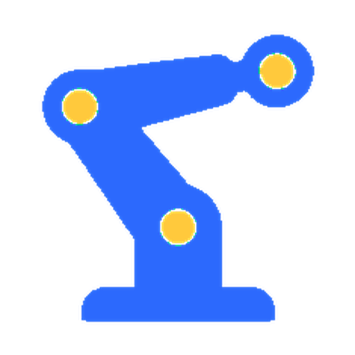
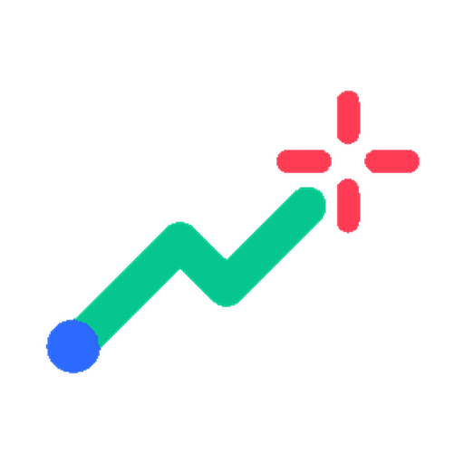
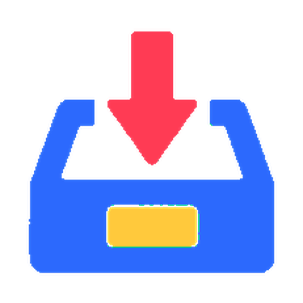
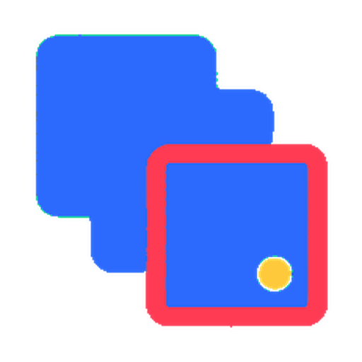

# NEWPATH

[中文](README.md) | **English**

A parametric toolpath library for large-format pellet 3D printing in Grasshopper. **1\.2\.4 · 37 components · Rhino 8 / Python 3**

NEWPATH connects geometry slicing, path editing, print sequencing, bead preview, and G-code output on a single Grasshopper canvas. Start with a model or manually drawn layer curves, combine components to suit your design, and inspect and adjust the toolpath as you go.

## Key benefits

- **Keep process data with the path**: PATH packets carry curves, layer indices, per-point heights, bead widths, and motion information, so slicing, editing, preview, and output share the same data.
- **Design paths around construction needs**: Combine double walls, ribs, end supports, brims, and infill to adjust local details. Organise execution through grouping, continuous paths, or layer-by-layer printing.
- **Inspect the process before export**: Examine curves, pointwise motion, and bead meshes, then simulate the print-head motion described by the G-code.
- **Use it directly in Grasshopper**: One `NEWPATH.gha` provides 37 independent components with embedded algorithms and icons. Component names and descriptions are Chinese; port identifiers remain English and categories use seven Chinese labels. Names below follow the manifest; English translations are provided for reference.

## Download and install

Requirements: **Windows, Rhino 8.20 or later, Grasshopper, and Rhino Python 3**. All 37 components are provided in one net48 GHA for Framework and Core modes. See the validation scope below. Mac has not been validated.

1. Download `NEWPATH_1\.2\.4\.gha` from [GitHub Releases](https://github.com/LIUWEILIN30/NEWPATH/releases) when available; no installation ZIP is provided.
2. Save your work and close every Rhino window. In Grasshopper’s Libraries folder, move out old NEWPATH GHA files and the standalone `NEWPATH.DeviceSettings.gha` / `NEWPATH.Toolbar.gha`, then copy in exactly one current GHA. Keep backups outside Libraries.
3. Restart Rhino and Grasshopper. NEWPATH has seven Chinese categories; the robotics category has primary, secondary and tertiary toolbar sections.

For manual installation, open **File → Special Folders → Libraries Folder** in Grasshopper and copy in `NEWPATH_1\.2\.4\.gha`. First move out legacy NEWPATH ghuser files and `NEWPATH.Toolbar.gha` and the former `NEWPATH.DeviceSettings.gha` to avoid duplicate entries. No separate icons or external Python sources are needed; execution still requires Rhino Python 3.

To switch runtime modes, run `SetDotNetRuntime` and restart Rhino; no different GHA is needed. Same-version updates also require closing all Rhino windows, replacing the file, and restarting. Legacy ghuser/Python instances retain their code; existing GHA instances resolve by their original GUIDs. Updated companion inputs require placing new components from the toolbar and reconnecting them. Hover over input ports for Chinese descriptions and default behaviour; connected inputs use incoming data.

## Workflow

- **Continuous printing**: Smart Slicer → Path Grouping → optional path edits → Continuous Path → optional PATH to G1 / PATH to G2 G3 → Path G-code → G-code Export or Upload.
- **Multiple objects, layer by layer**: slicing → optional path edits → optional PATH to G1 / PATH to G2 G3 → Layer-by-Layer Printing → Path G-code → G-code Export or Upload. Input models must share a common layer-index reference. Within each layer, paths are ordered as brim, infill, then outer walls. Supply paths that have not yet been joined into continuous paths, and connect directly to G-code generation afterwards; regrouping or continuous-path assembly may change the order.

Use Open Continuous Path for open contours, UV Slicer for layer curves along a surface parameter direction, or Pack Path for manually drawn parallel layer curves. Each component has specific input requirements; see its port tooltips.

Connect processing nodes through their **Path** data ports. `Preview` displays geometry and cannot replace the packet carrying process attributes. Recompute PATH data upstream rather than using Internalise to store it across sessions. Trigger `Run` again on Continuous Path after saving and reopening.

Before generating G-code, check millimetre units, machine travel limits, temperature, speed, and extrusion settings. Arc output requires controller support for XY-plane G2/G3. Upload uses Moonraker and requires your machine address and any required API key. `Upload` defaults to off; uploading does not start printing. Historical equipment testing is limited to the Jinshi FGF 1800 large-format pellet printer; other machines require adaptation. **Version 1.1.0 has not yet been tested in a physical print.**

## All components

The 37 components follow the seven toolbar categories. Icons are displayed at 80×80; the repository provides 512×512 transparent PNGs for component icons, and the template library icon is embedded since 1.2.3. All components are installed through the same GHA.

### 1 切片

| Icon | Component | Function |
|---|---|---|
|  | **UV方向切片** (UV Slicer) | Creates conformal slices along a selected surface parameter direction, recording per-point heights and growth directions. |
|  | **智能切片** (Smart Slicer) | Slices geometry using layer heights and end planes, producing paths with bead widths and per-point attributes. |
|  | **打包Path** (Pack Path) | Packages manually drawn parallel layer curves as Path data, preserving actual layer heights and provenance. |

### 2 Path编辑

| Icon | Component | Function |
|---|---|---|
|  | **双层墙路径** (Double Wall Path) | Offsets closed wall curves inward and creates double-wall paths at specified connection points. |
|  | **双道结构肋** (Double-Track Rib) | Creates paired out-and-back ribs inside walls using location points, layer ranges, and an overhang angle. |
|  | **生成brim** (Generate Brim) | Adds outward brim loops around contours touching the build plane while retaining original model paths. |
|  | **生成包围brim** (Generate Surrounding Brim) | Creates a closed brim surrounding all models at their base. |
|  | **端部偏移** (End Offset) | Offsets wall ends inward or outward, layer by layer, within a specified layer range. |
|  | **端部承托** (End Support) | Thickens double walls across specified end-layer ranges to form support surfaces. |
|  | **蛇形填充** (Zigzag Infill) | Adds zigzag bottom infill using a specified layer range and scan spacing. |
|  | **螺旋填充** (Spiral Infill) | Adds spiral infill to selected layers of the first model group while retaining all original paths. |

### 3 Path组织

| Icon | Component | Function |
|---|---|---|
|  | **开放连续路径** (Open Continuous Path) | Alternates successive open layer curves in a group and joins them into a back-and-forth printing path. |
|  | **路径分组** (Path Grouping) | Repartitions paths into print blocks at specified heights, with optional colours for each block. |
|  | **连续路径** (Continuous Path) | Adjusts closed-loop seams using guide points and joins slices in a group into a continuous extrusion path. |
|  | **PATH转G2 G3** (PATH to G2 G3) | Fits lines and arcs to paths and rebuilds them within tolerance and segment-length limits. |
|  | **PATH转G1** (PATH to G1) | Samples Path curves by length or geometric features to create G1 paths while preserving per-point attributes. |
|  | **逐层打印** (Layer-by-Layer Printing) | Organises printing by actual layer index, ordering brim, infill, and outer walls within each layer. |

### 4 导出

| Icon | Component | Function |
|---|---|---|
|  | **G-code上传** (G-code Upload) | Saves G-code locally and uploads it to the specified printing device. |
|  | **G-code导出** (G-code Export) | Estimates printing time and material usage, and saves instructions to a selected directory when triggered. |
|  | **Path G-code生成** (Path G-code) | Generates printing instructions from continuous paths and speed, temperature, and extrusion settings. |

### 5 分析

| Icon | Component | Function |
|---|---|---|
|  | **Path逐点运动** (Pointwise Path Motion) | Reads original path points and outputs coordinates, indices, and incoming motion types. |
|  | **解包Path** (Unpack Path) | Splits a path packet into layer planes, curves, nominal layer heights, and original point lists. |
|  | **路径预览** (Path Preview) | Previews printed bead meshes using per-point widths and heights from Path data. |
|  | **Gcode运动模拟** (G-code Motion Simulator) | Parses G-code and plays print-head motion at the specified speeds, showing the travelled path. |

### 6 工具

| Icon | Component | Function |
|---|---|---|
|  | **打印床** (Print Bed) | Displays a print bed from its device name and dimensions, and outputs a world-horizontal reference plane. |
|  | **水平偏移曲面** (Horizontal Surface Offset) | Offsets surfaces by a horizontal distance, with an option to close them into walls. |

### 7 机器人 · Robotics

The robotics category uses primary, secondary and tertiary columns.

| Icon | Component | Function |
|---|---|---|
|  | **基座坐标逆变换** (Base Inverse) | Inverts the taught base pose through one RS input and output while passing through other system data. |
|  | **Tool与Base设置** | Stores TCP, tool mesh, payload, print pose and TOOL/BASE numbers in one independent packet. |
|  | **设备六轴姿态** (Joint Pose) | Edits, switches and saves six-axis joint presets. |
|  | **Path机器人目标生成** (Robot Target Generation) | Converts Path data and the tool/base packet into start, printing and return targets. |
|  | **RoBIM播放控制** (Playback Control) | Provides pause, seek, speed and reset controls for simulation time. |
|  | **机器人程序导出** (Robot Program Export) | Validates names, appends numeric iterations, and exports consistent declarations, calls and filenames. |
|  | **加载机器人系统** (Load Robot System) | Loads a supported robot system for target generation, program calculation and simulation. |
|  | **角度转弧度** (Degrees to Radians) | Converts six-axis angles to radians for robot target generation. |
|  | **创建程序** (Create Program) | Calculates robot motion from targets and generates KUKA KRL code. |
|  | **程序模拟** (Program Simulation) | Outputs robot meshes, TCP plane and six-axis angles at a program time. |
| — | **模板素材库** (Template Library) | Manages, imports and exports tem templates and GH canvas assets. |

Load Robot System, Degrees to Radians, Create Program and Program Simulation are developed by NEWPATH, bundled with the library and do not depend on official RoBIM components. Native RoBIM object interoperability in Path机器人目标生成 and 机器人程序导出 requires a compatible RoBIM installation. Configuration, base-transform mathematics and playback timing do not reference RoBIM assemblies. Connect Name to the export component; Create Program may retain its built-in placeholder. Iterations are named `TEST001`, `TEST002`, with KUKA's 24-character module-name limit checked.

## Version changes

**1.1.0 (2026-10-20)** combines accepted path updates and six robotics components in one GHA, for 32 components. A seventh category adds two columns while preserving the original six groups. The experimental single-spiral infill component is excluded; the existing Spiral Infill remains included.

- New target, playback and program-export components create 11, 4 and 3 companion controls respectively.
- All six companion sets, including G-code generation/export/upload, align by actual grips: 40 controls total. Alignment is bounded to creation and the initial solve; later dragging is unrestricted. Reopen and duplication do not create another input set.
- Tool与Base设置 connects through one packet. Program export configures consistent names and numeric iteration suffixes, with UNC share-root cleanup corrected.
- All robotics components have transparent icons. Pack Path uses the current integer Role options (0–3).

**1.0.5 (2026-10-15, updated through 2026-10-16)** fixes loading in .NET Framework mode, retains all 26 component GUIDs and ports, and adds the following updates:

- Placing G-code generation, export, or upload from the toolbar creates and connects 14, 4, or 4 companion input objects respectively, preserving values, ranges, precision, text, and options. Path/GCode data ports still require connections. Saving/reopening or copying existing components does not generate duplicate inputs.
- Companion inputs for G-code generation align by actual wire endpoints: both ends of each wire share a height, and source output grips share one column. Alignment runs after placement and the first solve; it does not constrain later dragging or rearrange existing canvases.
- Smart Slicer accepts .NET `IList` at its `Planes` input.
- Each of the six toolbar categories uses two columns, retaining component identities and ports.

**1.0.4 (2026-10-15)** retains all 26 functions from 1.0.3 as independently registered components in one GHA. It updates continuous paths, open continuous paths, UV slicing, brim generation, G-code generation and upload, and the shared runtime. Compared with the 25 components in 1.0.2, this version includes Layer-by-Layer Printing for sequencing multiple objects by actual layer index.

The current 131 inputs have descriptions, with fixed defaults updated to the current contracts and stored in the ports. Dynamic defaults are calculated as explained in the tooltips. Defaults follow the current algorithms; custom values from old examples are not migrated automatically.

## Validation and license

The same final 1.1.0 GHA passed registration, icons, ports, component archives, representative PATH chains, bead preview and save/reopen in independent Windows Rhino 8 processes using Framework 4.8 and .NET 8.0.14. Both modes verified actual grip alignment for all 40 companion controls and no duplicate inputs after reopen. Robotics functionality was checked with existing data in .NET 8, retaining the poses, joints and tool TCP of 436 targets. This release has not been validated by controller compilation, robot motion, network upload or physical printing. RoBIM availability in other modes and versions depends on the third-party plugin's own support.

Validation of 1.0.4 included 100 offline regressions, structural checks for 21 PATH components, and registration, new-instance, icon, source, port, and default checks for all 26 components. Representative chains covered two-object layer-by-layer printing, continuous paths with brim and infill, and open continuous paths from UV slices. Save/reopen and development-directory isolation checks were also completed.

The earlier 1.0.5 compatibility build passed registration, port, and default checks for all 26 components in separate Rhino 8.20 processes running Framework 4.8 and .NET 8.0.14. Both modes passed Pack Path → G1 conversion → Layer-by-Layer Printing → G-code generation → export analysis, including save/reopen. Additional .NET 8 checks covered brim, infill, continuous paths, and UV open paths. A subsequent companion-input build was checked in .NET 8 for creation, settings, instance identities, and archive readback of all 22 inputs.

Later Smart Slicer and input-alignment fixes passed checks using real GH attributes in a separate .NET Framework process: metadata for all 26 components, alignment of all 14 inputs at three positions, recovery of a displaced first slider, and repeated alignment. That 1.0.5 toolbar-column update passed separate-process readback checks but has not received live Rhino toolbar visual acceptance. That 1.0.5 build has not repeated full solving in both runtime modes, save/reopen, or acceptance after installation and a Rhino restart. Earlier live results do not establish equivalent acceptance of the latest binary.

Network upload, physical printing, and installation after an operating-system restart have not been tested for 1.0.5. These checks reflect the environments and inputs of their respective builds; they do not establish compatibility with every device or canvas combination.

This repository provides bilingual documentation and icons. Installation attachments are distributed through [GitHub Releases](https://github.com/LIUWEILIN30/NEWPATH/releases). Licensed under the [MIT License](LICENSE). The GHA embeds the Python algorithms required at runtime and does not provide source confidentiality.

The 1.1.0 category/name correction uses seven Chinese category labels, renames Tool/Base setup, and hides the legacy TCP entry. All exported objects in the corrected assembly were inspected: seven registered groups, 32 visible components and 75 resources. The live runtime results above refer to the preceding functional build; this metadata correction has not repeated live Rhino solves.

**1.1.1 (2026-10-20)** changes the target generator input display name to `toolbasesetup`, synchronizing its script variable while retaining the legacy `Tool` source alias. Components keep Chinese display names and descriptions; port labels remain English. Delivery is a single versioned GHA; private loadable sources stay local. Current checks and remaining live-runtime coverage are recorded separately from historical validation.

**1.1.2 (2026-10-20)** normalizes the input name to `ToolBaseSetup`, following PascalCase port naming.

**1.1.3 (2026-10-21)** restores functional descriptions and Chinese display names, status text and owned diagnostics. Native surface fields use `ToolBaseSetup` and `JointPose`; the target input formally uses `ToolBaseSetup` while preserving legacy aliases. Compilation, structure/copy checks and offline base, playback and export regressions passed. Live dual-runtime Rhino and save/reopen checks have not been repeated for this binary.

**1.1.4 (2026-10-21)** follows the current development-canvas source contracts and restores the missing `Flip` (surface ribs), `Angle` (end offset), and `GuidePoint` (spiral infill) inputs. The library retains 32 components and seven groups, with descriptions derived from the authoritative sources. Checks covered structure and resources, all 32 component metadata/archive roundtrips in Rhino .NET 8, alignment of 40 companion inputs, and spiral-infill output using existing canvas data. Framework live solves, save/reopen and development-directory isolation have not been repeated for this binary.

**1.1.5 (2026-10-21)** promotes the accepted G1/G2 performance implementations while preserving component GUIDs and ports. G1 embeds its local conversion backend and does not read development/test files at runtime. Algorithm parity, structure and resources were checked; live Rhino dual-runtime solves and save/reopen have not been repeated for this binary.
